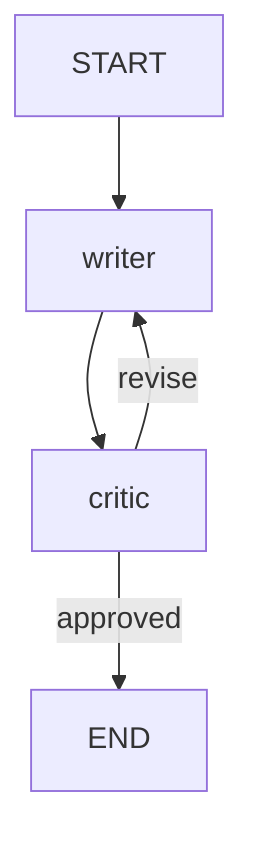

# 🔁 LangGraph Writer–Critic

A tiny [LangGraph](https://langchain-ai.github.io/langgraph/) project showing a **self-improving loop**:
a *writer* node drafts a paragraph, a *critic* node reviews it, and the graph loops until the critic approves (or 3 revisions are reached).



## What you'll learn
- Defining shared **State** with `TypedDict`
- Writing **nodes** as plain Python functions
- **Conditional edges** for looping / branching
- Streaming step-by-step output with `stream_mode="updates"`

## Setup
```bash
git clone <your-repo-url> && cd langgraph-writer-critic
python -m venv .venv && source .venv/bin/activate   # Windows: .venv\Scripts\activate
pip install -r requirements.txt
cp .env.example .env    # then add your free GOOGLE_API_KEY
```

## Free API key
Get a free Gemini key (no credit card) at <https://aistudio.google.com/app/apikey> and put it in `.env` as `GOOGLE_API_KEY`.
Free tier is rate-limited, so if you see a 429 error, wait a minute and retry.
Prefer Claude? Set `LLM_PROVIDER=anthropic` and `ANTHROPIC_API_KEY`, and `pip install langchain-anthropic`.

## Run
```bash
python main.py "benefits of morning walks"
python main.py --diagram      # print the graph as Mermaid
```

## Project structure
```
├── main.py          # CLI entry point
├── src/graph.py     # state, nodes, routing, graph
├── requirements.txt
└── .env.example
```

## Ideas to extend
- Add a human-in-the-loop approval node
- Swap in a web-search tool for the writer
- Add memory with a LangGraph checkpointer

## License
MIT
